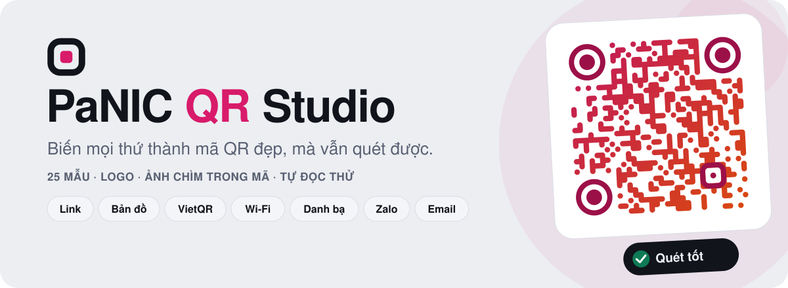
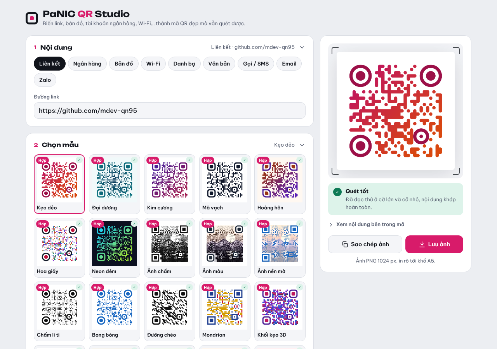
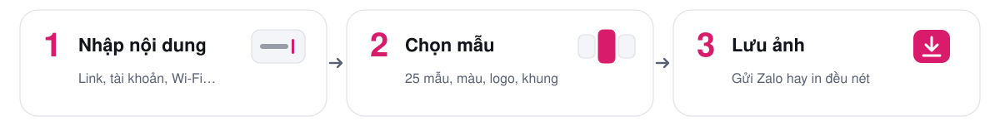
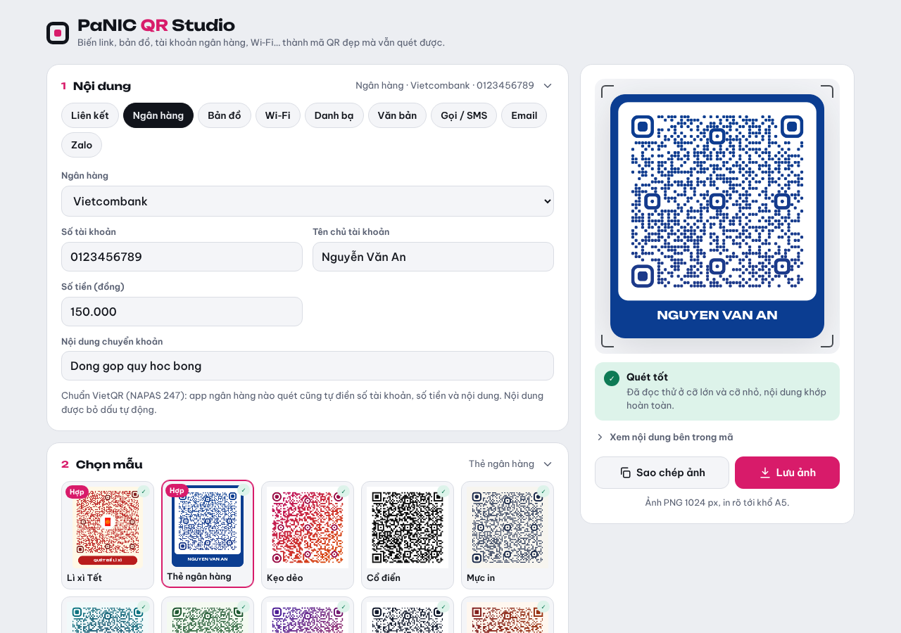
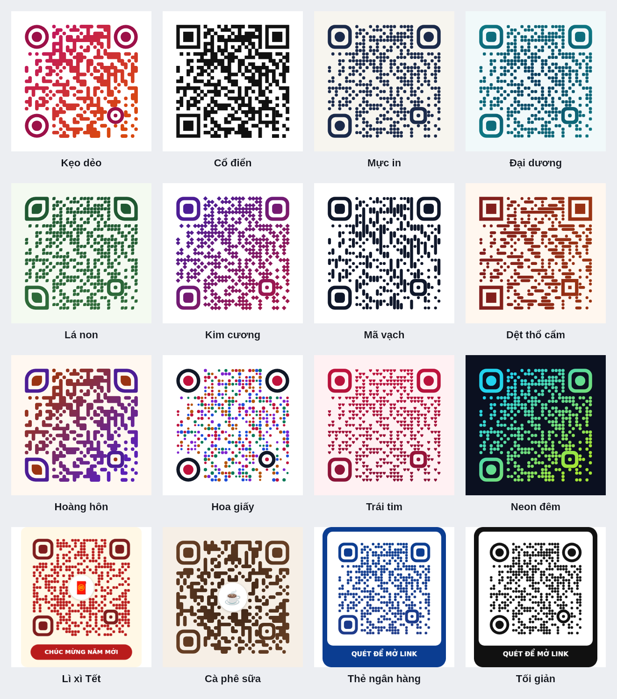
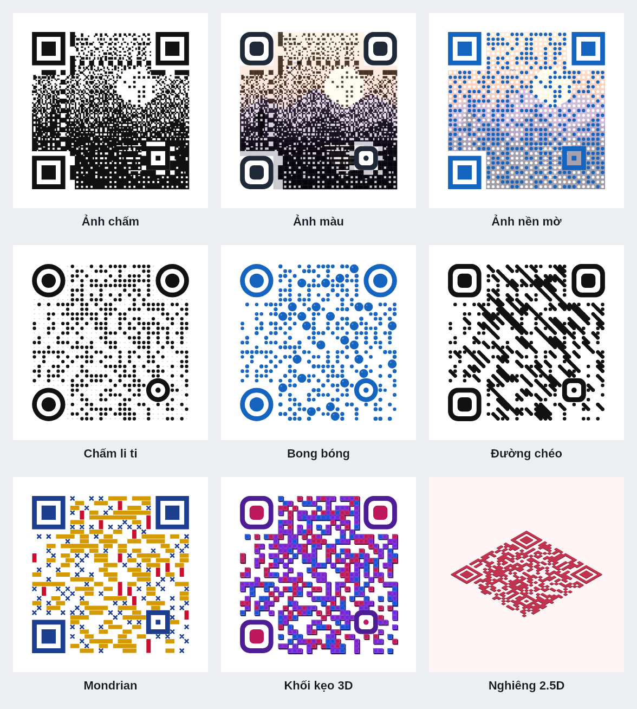
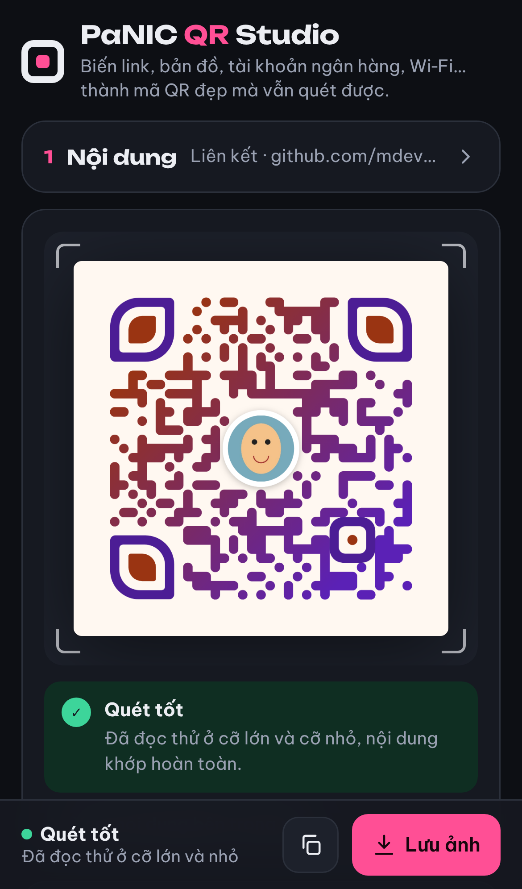
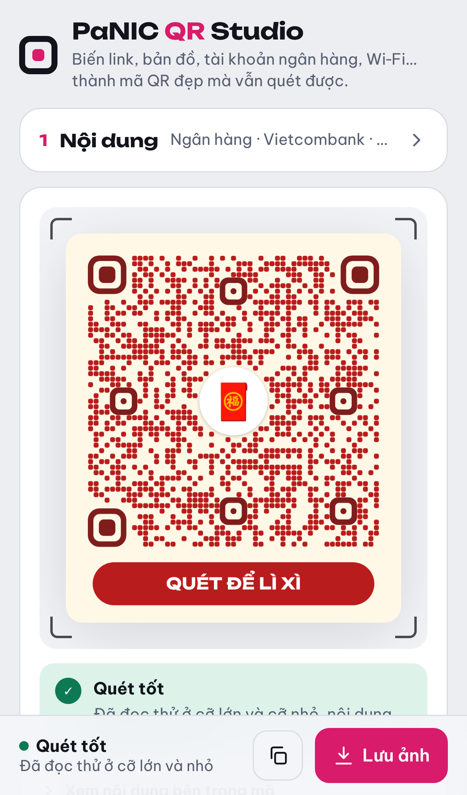

  <picture>
    <source media="(prefers-color-scheme: dark)" srcset="assets/banner-dark.svg">
    
  </picture>

  

  Link, bản đồ, tài khoản ngân hàng, Wi‑Fi, danh bạ… nhập vào là có mã QR. 
  Chọn một trong 25 mẫu, thêm logo hay ảnh của bạn, rồi lưu về máy. 
  Mã nào cũng được tự đọc thử trước, nên đẹp mà vẫn quét được.

  

## Ba bước là có mã

<picture>
  <source media="(prefers-color-scheme: dark)" srcset="assets/steps-dark.svg">
  
</picture>

## Biến gì thành mã QR cũng được

<picture>
  <source media="(prefers-color-scheme: dark)" srcset="assets/types-dark.svg">
  
</picture>

| Loại | Quét xong sẽ |
|---|---|
| **Liên kết** | Mở trang web |
| **Ngân hàng (VietQR)** | Mở app ngân hàng, điền sẵn số tài khoản, số tiền và nội dung chuyển khoản |
| **Bản đồ** | Chỉ đường tới địa chỉ, tọa độ hoặc link Google Maps |
| **Wi‑Fi** | Vào mạng ngay, không cần gõ mật khẩu |
| **Danh bạ** | Lưu họ tên, số điện thoại, email, công ty vào danh bạ |
| **Gọi / SMS** | Gọi điện hoặc mở tin nhắn soạn sẵn |
| **Email** | Mở thư mới với người nhận, tiêu đề, nội dung |
| **Zalo** | Mở thẳng cửa sổ chat Zalo |
| **Văn bản** | Hiện một đoạn chữ bất kỳ |

## Chuyển khoản bằng VietQR

Chọn ngân hàng trong danh sách 33 ngân hàng, nhập số tài khoản, số tiền và nội dung. App ngân hàng nào cũng quét được. Tên chủ tài khoản có thể hiện ngay trên nhãn của mã, rất hợp để in dán quầy hay gửi kèm hóa đơn.

## 25 mẫu, chọn là có

**16 mẫu cơ bản**, từ cổ điển đến Kẹo dẻo, Lá non, Dệt thổ cẩm, Neon đêm, Lì xì Tết, Cà phê sữa, Thẻ ngân hàng…

**9 mẫu nghệ thuật**: ảnh của bạn hiện ra ngay trong mã, bong bóng, đường chéo, Mondrian, khối kẹo 3D, mã nghiêng nổi khối.

Khi bạn đổi loại nội dung, các mẫu hợp với loại đó được đưa lên đầu và gắn nhãn **Hợp**.

## Tự tay tinh chỉnh

- **18 kiểu chấm**: vuông, tròn, bo góc, liền mạch, lá, thoi, thanh dọc, thanh ngang, hoa giấy, trái tim, chấm li ti, bong bóng, đường chéo, Mondrian, khối 3D, nghiêng 2.5D, ảnh chấm, ảnh nền
- **Mắt định vị**: chỉnh riêng viền và lõi của ba ô vuông lớn ở góc
- **Màu sắc**: đơn sắc hoặc chuyển màu dọc, ngang, chéo, tỏa tròn
- **Ảnh chìm trong mã**: chọn ảnh chân dung hay phong cảnh, giữ màu hoặc chuyển đen trắng
- **Khung và nhãn**: nhãn tự đổi theo mẫu và nội dung, ví dụ “QUÉT ĐỂ LÌ XÌ” hay tên chủ tài khoản, hoặc tự gõ nhãn của bạn
- **Mức sửa lỗi**: chọn mức chịu hỏng từ 7% đến 30%, có giải thích ngay bên cạnh

## Logo ở giữa mã

Đặt ảnh logo, biểu tượng hoặc vài chữ cái vào giữa mã. Ảnh nào cũng được tự cắt vừa khung tròn hoặc bo góc, không bị méo, kèm viền trắng nổi hoặc viền theo màu mã.

## Luôn quét được

- Mỗi lần bạn chỉnh, mã được tự đọc thử ở cỡ lớn và cỡ nhỏ, rồi báo **Quét tốt**, **Quét được** hoặc **Chưa quét được**
- Nếu chưa quét được, bấm **Sửa tự động**: trang chỉnh ít nhất có thể cho tới khi mã đọc được
- Những kiểu mắt định vị dễ làm máy quét đọc sai sẽ tự bị khóa
- Mỗi mẫu trong danh sách có dấu ✓ khi đã đọc thử thành công với nội dung của bạn

## Làm cho điện thoại trước tiên

- Thẻ nội dung thu gọn được, chỉ còn một dòng tóm tắt khi đã nhập xong
- Dải mẫu cuộn ngang, phần tinh chỉnh chia thành từng mục mở ra khi cần
- Thanh dưới cùng luôn có nút **Lưu ảnh** và trạng thái quét, tự ẩn khi bàn phím bật lên
- Giao diện sáng và tối theo điện thoại

  

## Lưu và chia sẻ

- **Lưu ảnh**: trên iPhone mở bảng chia sẻ, chọn “Lưu hình ảnh” là ảnh vào thẳng app Ảnh; trên máy tính tải về ảnh PNG 1024 px, in rõ tới khổ A5
- **Sao chép ảnh** rồi dán thẳng vào Zalo, Messenger, Word
- Trang nhớ lựa chọn, logo và ảnh của lần trước, và chạy được cả khi không có mạng
- Mọi thứ, kể cả ảnh bạn chọn, chỉ được xử lý ngay trên máy của bạn

  

## Thêm vào màn hình chính iPhone

Mở website bằng Safari → Chia sẻ → Thêm vào MH chính → Thêm. Nếu có tuỳ chọn “Mở dưới dạng ứng dụng web”, hãy bật tuỳ chọn đó.

Nếu đã thêm biểu tượng trước khi cập nhật, hãy gỡ biểu tượng cũ và thêm lại từ Safari sau khi bản cập nhật đã triển khai. Web cung cấp icon PNG 180×180 cho iPhone và manifest với chế độ `standalone` để mở độc lập, không có thanh địa chỉ Safari.
